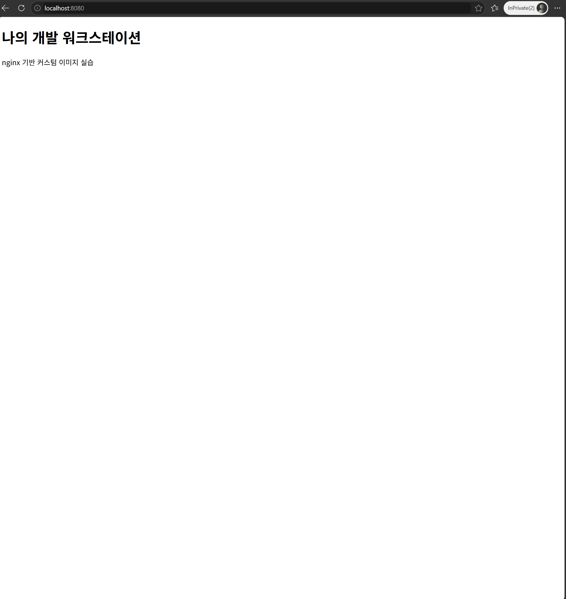
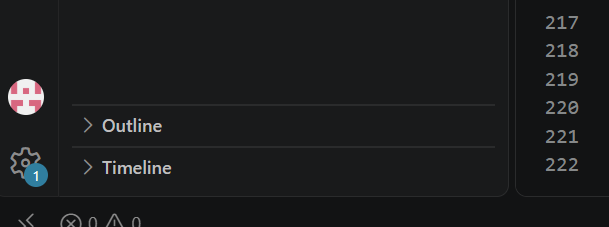

# 개발 워크스테이션 구축 — 터미널 · Docker · Git

## 1. 프로젝트 개요

"내 컴퓨터에서만 돌아가는" 문제를 줄이고, 누구나 같은 방식으로 실행·확인할 수 있는 개발 환경을 직접 구성한다.

- 리눅스 터미널로 작업 디렉토리와 파일 권한을 다룬다
- Docker를 점검하고, 컨테이너를 실행·관리·정리한다
- 기존 nginx 이미지를 바탕으로 Dockerfile을 작성해 커스텀 웹 서버 이미지를 만든다
- 포트 매핑으로 접속을 확인하고, 바인드 마운트(변경 반영)와 볼륨(데이터 유지)을 검증한다
- Git을 설정하고 VSCode에서 GitHub 저장소와 연동한다

모든 작업은 터미널에서 수행했으며, `script` 명령으로 터미널 입력과 출력을 그대로 녹화해 [`logs/`](./logs) 폴더에 보관했다.

---

## 2. 실행 환경

| 항목 | 내용 | 확인 명령 |
|---|---|---|
| 호스트 OS | Windows + WSL2 | - |
| 리눅스 | Ubuntu 26.04.1 LTS | `cat /etc/os-release` |
| 커널 | 6.18.54.1-microsoft-standard-WSL2 | `docker info` |
| 쉘 | bash (`/bin/bash`) | `echo $SHELL` |
| 터미널 | Windows PowerShell에서 `wsl -d Ubuntu`로 Ubuntu 진입 | - |
| Docker | Docker version 29.9.2 (Docker Desktop 4.97.0, WSL2 백엔드) | `docker --version` |
| Git | git version 2.53.0 (Ubuntu 내부) | `git --version` |
| 에디터 | VSCode (WSL 원격 연결) | - |

> **재현 시 주의**
> - 작업은 Ubuntu 홈 디렉토리(`/home/사용자명`) 아래에서 진행했다. `/mnt/c/...`(Windows 폴더)에서는 리눅스 권한(`chmod`)이 정상 적용되지 않는다.
> - Docker Desktop 설정 → Resources → WSL integration에서 Ubuntu 연동을 켜야 Ubuntu 안에서 `docker` 명령을 쓸 수 있다.
> - 기본 WSL 배포판이 `docker-desktop`으로 잡혀 있으면 `wsl`만 입력했을 때 작업용 Ubuntu가 아닌 곳으로 들어간다. `wsl -d Ubuntu`로 명시해서 진입한다.

---

## 3. 수행 체크리스트

| 평가 항목 | 결과 | 근거 |
|---|---|---|
| 폴더/파일 생성·이동·삭제 | ✅ | [5. 터미널 기본 조작](#5-터미널-기본-조작) |
| 파일 권한 변경 결과 확인 | ✅ | [6. 파일 권한](#6-파일-권한) |
| `docker --version` 출력, Docker 동작 상태 | ✅ | [7. Docker 설치 점검](#7-docker-설치-점검) |
| `docker run hello-world` 정상 실행 | ✅ | [8-1. hello-world](#8-1-hello-world) |
| 이미지/컨테이너 목록 확인 및 정리 | ✅ | [8-2](#8-2-이미지-다운로드-및-목록), [8-6](#8-6-컨테이너이미지-정리) |
| Dockerfile로 이미지 빌드 | ✅ | [9. Dockerfile 커스텀 이미지](#9-dockerfile-커스텀-이미지) |
| 매핑된 포트로 접속 | ✅ | [10. 포트 매핑](#10-포트-매핑-접속) |
| (요구사항) 바인드 마운트 변경 반영 | ✅ | [11. 바인드 마운트](#11-바인드-마운트-변경-반영) |
| Docker 볼륨 데이터 유지 | ✅ | [12. 볼륨](#12-docker-볼륨-데이터-영속성) |
| Git 설정 및 GitHub 연동 | ✅ | [13. Git / GitHub](#13-git-설정-및-github-연동) |
| 트러블슈팅 2건 이상 | ✅ (7건) | [14. 트러블슈팅](#14-트러블슈팅) |

---

## 4. 저장소 구조

```
.
├── README.md
├── web/
│   ├── Dockerfile          # nginx:alpine 기반 커스텀 이미지
│   └── site/
│       └── index.html      # 교체한 정적 페이지
├── practice/               # 터미널·권한 실습 폴더
├── images/                 # 접속 화면, GitHub 연동 캡처
└── logs/                   # script 명령으로 녹화한 원본 터미널 로그
```

---

## 5. 터미널 기본 조작

원본 로그: [`logs/terminal_log_step1.txt`](./logs/terminal_log_step1.txt)

```bash
$ cd ~
$ pwd
/home/user
$ mkdir -p ~/codyssey/practice
$ cd ~/codyssey/practice
$ pwd
/home/user/codyssey/practice
$ ls -la
total 16
drwxr-xr-x 3 user user 4096 Nov  9 11:12 .
drwxr-xr-x 3 user user 4096 Nov  9 11:14 ..
-rw-r--r-- 1 user user    0 Nov  9 11:09 empty.txt
-rw-r--r-- 1 user user   23 Nov  9 11:10 note.txt
drwxr-xr-x 2 user user 4096 Nov  9 11:12 perm_dir
$ touch empty.txt
$ echo "codyssey 실습 파일" > note.txt
$ cat note.txt
codyssey 실습 파일
$ cp note.txt note_copy.txt
$ mv note_copy.txt note_renamed.txt
$ ls -la
total 20
drwxr-xr-x 3 user user 4096 Nov  9 11:15 .
drwxr-xr-x 3 user user 4096 Nov  9 11:14 ..
-rw-r--r-- 1 user user    0 Nov  9 11:15 empty.txt
-rw-r--r-- 1 user user   23 Nov  9 11:15 note.txt
-rw-r--r-- 1 user user   23 Nov  9 11:15 note_renamed.txt
drwxr-xr-x 2 user user 4096 Nov  9 11:12 perm_dir
$ rm note_renamed.txt
$ mkdir temp_dir
$ ls -la
total 20
drwxr-xr-x 4 user user 4096 Nov  9 11:15 .
drwxr-xr-x 3 user user 4096 Nov  9 11:14 ..
-rw-r--r-- 1 user user    0 Nov  9 11:15 empty.txt
-rw-r--r-- 1 user user   23 Nov  9 11:15 note.txt
drwxr-xr-x 2 user user 4096 Nov  9 11:12 perm_dir
drwxr-xr-x 2 user user 4096 Nov  9 11:15 temp_dir
$ rmdir temp_dir
$ ls -la
total 16
drwxr-xr-x 3 user user 4096 Nov  9 11:16 .
drwxr-xr-x 3 user user 4096 Nov  9 11:14 ..
-rw-r--r-- 1 user user    0 Nov  9 11:15 empty.txt
-rw-r--r-- 1 user user   23 Nov  9 11:15 note.txt
drwxr-xr-x 2 user user 4096 Nov  9 11:12 perm_dir
```

| 수행 항목 | 명령 | 확인 결과 |
|---|---|---|
| 현재 위치 확인 | `pwd` | `/home/user/codyssey/practice` |
| 숨김 포함 목록 | `ls -la` | `.`(현재 폴더), `..`(상위 폴더) 표시 |
| 생성 | `mkdir -p`, `echo >` | 폴더·파일 생성 |
| 이동 | `cd` | 경로 변경 |
| 빈 파일 생성 | `touch` | `empty.txt` 크기 0 |
| 내용 확인 | `cat` | 파일 내용 출력 |
| 복사 | `cp` | `note_copy.txt` 생성 |
| 이름 변경 | `mv` | `note_copy.txt` → `note_renamed.txt` |
| 삭제 | `rm`, `rmdir` | 목록에서 사라짐 |

**관찰** — 이미 있던 `empty.txt`에 `touch`를 다시 실행하자 수정 시각이 `11:09` → `11:15`로 바뀌었다. `touch`는 파일이 없으면 빈 파일을 만들고, 있으면 수정 시각만 갱신한다.

---

## 6. 파일 권한

원본 로그: [`logs/terminal_log.txt`](./logs/terminal_log.txt)

### 파일 (note.txt)
```bash
$ ls -l note.txt
-rw-r--r-- 1 user user 23 Nov  9 11:10 note.txt
$ chmod 600 note.txt
$ ls -l note.txt
-rw------- 1 user user 23 Nov  9 11:10 note.txt
$ chmod 644 note.txt
$ ls -l note.txt
-rw-r--r-- 1 user user 23 Nov  9 11:10 note.txt
```

| 단계 | 표기 | 숫자 | 의미 |
|---|---|---|---|
| 변경 전 | `-rw-r--r--` | 644 | 소유자 읽기·쓰기, 나머지 읽기만 |
| 600 적용 | `-rw-------` | 600 | 소유자만 읽기·쓰기, 나머지 접근 불가 |
| 644 복원 | `-rw-r--r--` | 644 | 원래대로 |

### 디렉토리 (perm_dir)
```bash
$ mkdir perm_dir
$ ls -ld perm_dir
drwxr-xr-x 2 user user 4096 Nov  9 11:12 perm_dir
$ chmod 700 perm_dir
$ ls -ld perm_dir
drwx------ 2 user user 4096 Nov  9 11:12 perm_dir
$ chmod 755 perm_dir
$ ls -ld perm_dir
drwxr-xr-x 2 user user 4096 Nov  9 11:12 perm_dir
```

| 단계 | 표기 | 숫자 | 의미 |
|---|---|---|---|
| 변경 전 | `drwxr-xr-x` | 755 | 소유자 모든 권한, 나머지 읽기·진입 |
| 700 적용 | `drwx------` | 700 | 소유자만 진입 가능 |
| 755 복원 | `drwxr-xr-x` | 755 | 원래대로 |

> 디렉토리는 `ls -l`이 아닌 `ls -ld`로 확인한다. `-d`가 없으면 디렉토리 자체가 아닌 내부 목록이 출력된다.

**관찰** — 새로 만든 파일은 `644`, 디렉토리는 `755`로 생성됐다. 리눅스는 파일 기본값 `666`, 디렉토리 기본값 `777`에서 `umask`(기본 `022`)를 빼서 초기 권한을 정하기 때문이다.

---

## 7. Docker 설치 점검

```bash
$ docker --version
Docker version 29.9.2, build a82e528

$ docker info
Client:
 Version:    29.9.2
 Context:    desktop-linux
...
Server:
 Containers: 2
  Running: 1
  Paused: 0
  Stopped: 1
 Images: 2
 Server Version: 29.9.2
 Storage Driver: overlayfs
 Cgroup Version: 2
 Kernel Version: 6.18.54.1-microsoft-standard-WSL2
 Operating System: Docker Desktop
 OSType: linux
 Architecture: x86_64
...
```

- 클라이언트와 서버(데몬) 버전이 모두 출력됨 → 데몬 정상 동작
- `Kernel Version`이 `WSL2` → Docker Desktop이 WSL2 기반 리눅스 위에서 동작
- `OSType: linux` → 리눅스 컨테이너 실행 환경

---

## 8. Docker 기본 운영

원본 로그: [`logs/terminal_log_docker.txt`](./logs/terminal_log_docker.txt)

### 8-1. hello-world
```bash
$ docker run hello-world

Hello from Docker!
This message shows that your installation appears to be working correctly.
...
```

### 8-2. 이미지 다운로드 및 목록
```bash
$ docker pull ubuntu
...
Status: Downloaded newer image for ubuntu:latest

$ docker pull nginx:alpine
...
Status: Downloaded newer image for nginx:alpine

$ docker images
IMAGE                 ID             DISK USAGE   CONTENT SIZE   EXTRA
hello-world:latest    c567b231f656       25.9kB         9.49kB    U
nginx:alpine          713fc2ebfd92       94.5MB         27.3MB
ubuntu:latest         6a06111c3b0a        163MB         45.9MB
```
> `EXTRA`의 `U`는 해당 이미지로 만든 컨테이너가 존재함(In Use)을 뜻한다.

### 8-3. ubuntu 컨테이너 실행과 내부 명령
```bash
$ docker run -it --name my-ubuntu ubuntu bash
root@a2b35cdc34c4:/# ls
bin  boot  dev  etc  home  lib  lib64  media  mnt  opt  proc  root  run  sbin  srv  sys  tmp  usr  var
root@a2b35cdc34c4:/# exit

$ docker ps
CONTAINER ID   IMAGE     COMMAND   CREATED   STATUS    PORTS     NAMES

$ docker ps -a
CONTAINER ID   IMAGE         COMMAND    CREATED              STATUS                          NAMES
a2b35cdc34c4   ubuntu        "bash"     About a minute ago   Exited (0) 10 seconds ago       my-ubuntu
c709738f98d0   hello-world   "/hello"   About a minute ago   Exited (0) About a minute ago   quirky_khorana
```
- 프롬프트가 `root@컨테이너ID:/#`로 바뀜 → 컨테이너 내부 진입
- `ls` 결과가 호스트 홈과 다른 기본 디렉토리 구조 → 격리된 파일 시스템
- `exit` 후 `docker ps`에서 사라지고 `docker ps -a`에서 `Exited (0)` → 정상 종료

### 8-4. exec와 attach 차이
```bash
$ docker start my-ubuntu
$ docker ps
CONTAINER ID   IMAGE     COMMAND   CREATED              STATUS         NAMES
a2b35cdc34c4   ubuntu    "bash"    About a minute ago   Up 5 seconds   my-ubuntu

# exec로 진입 후 종료
$ docker exec -it my-ubuntu bash
root@a2b35cdc34c4:/# echo "into exec"
into exec
root@a2b35cdc34c4:/# exit

$ docker ps
CONTAINER ID   IMAGE     COMMAND   CREATED         STATUS          NAMES
a2b35cdc34c4   ubuntu    "bash"    2 minutes ago   Up 43 seconds   my-ubuntu

$ docker stats --no-stream
CONTAINER ID   NAME        CPU %     MEM USAGE / LIMIT     MEM %     NET I/O         BLOCK I/O   PIDS
a2b35cdc34c4   my-ubuntu   0.00%     3.047MiB / 15.25GiB   0.02%     1.17kB / 126B   0B / 0B     1

# attach로 진입 후 종료
$ docker attach my-ubuntu
root@a2b35cdc34c4:/# exit

$ docker ps
CONTAINER ID   IMAGE     COMMAND   CREATED   STATUS    PORTS     NAMES

$ docker ps -a
CONTAINER ID   IMAGE    COMMAND   CREATED         STATUS                      NAMES
a2b35cdc34c4   ubuntu   "bash"    2 minutes ago   Exited (0) 10 seconds ago   my-ubuntu
```

| 구분 | exec | attach |
|---|---|---|
| 동작 | 컨테이너 안에 **새 프로세스**(bash)를 추가로 띄워 접속 | 컨테이너의 **주 프로세스**(PID 1)에 직접 연결 |
| `exit` 후 | 새로 띄운 bash만 종료 → **컨테이너 유지** (`Up 43 seconds`) | 주 프로세스 종료 → **컨테이너 종료** (`Exited (0)`) |
| 용도 | 실행 중인 서비스 점검·디버깅 | 주 프로세스의 입출력을 직접 볼 때 |

컨테이너는 주 프로세스가 살아 있는 동안만 실행된다. `docker stats`의 `PIDS 1`이 보여주듯 이 컨테이너의 주 프로세스는 처음 실행한 `bash` 하나뿐이고, attach는 그 bash에 붙었기 때문에 `exit`가 곧 컨테이너 종료가 된다.

### 8-5. 로그 확인
```bash
$ docker logs my-ubuntu
root@a2b35cdc34c4:/# ls
bin  boot  dev  etc  home  lib  lib64  media  mnt  opt  proc  root  run  sbin  srv  sys  tmp  usr  var
root@a2b35cdc34c4:/# exit
exit
root@a2b35cdc34c4:/# exit
exit
```
**관찰** — `docker logs`에는 처음 `run`했을 때와 `attach`했을 때의 화면만 남고, `exec`로 실행한 `echo "into exec"`는 나타나지 않았다. `docker logs`는 **주 프로세스의 출력만** 수집하기 때문이다.

### 8-6. 컨테이너·이미지 정리

원본 로그: [`logs/terminal_log_web.txt`](./logs/terminal_log_web.txt) 앞부분

```bash
$ docker ps -a
CONTAINER ID   IMAGE          COMMAND           CREATED          STATUS                      NAMES
a2b35cdc34c4   ubuntu         "bash"            38 minutes ago   Exited (0) 35 minutes ago   my-ubuntu
c709738f98d0   hello-world    "/hello"          39 minutes ago   Exited (0) 39 minutes ago   quirky_khorana
ab84f51d4dfd   hello-world    "/hello"          7 days ago       Exited (0) 7 days ago       elated_robinson
...

$ docker rm my-ubuntu quirky_khorana elated_robinson
my-ubuntu
quirky_khorana
elated_robinson

$ docker rmi hello-world
Untagged: hello-world:latest
Deleted: sha256:c567b231f65614688711a75f31518a064258a51d442117a3e771a3a8fdba78ef

$ docker images
IMAGE                 ID             DISK USAGE   CONTENT SIZE   EXTRA
nginx:alpine          713fc2ebfd92       94.5MB         27.3MB
ubuntu:latest         6a06111c3b0a        163MB         45.9MB
...
```
- 실습에 쓴 컨테이너를 **이름으로 지정해** 삭제했다. `docker container prune`(정지된 컨테이너 일괄 삭제)은 이번 과제와 무관한 기존 컨테이너까지 지울 수 있어 사용하지 않았다.
- 이미지는 그 이미지로 만든 컨테이너를 먼저 지운 뒤에 `docker rmi`로 삭제할 수 있다.

---

## 9. Dockerfile 커스텀 이미지

원본 로그: [`logs/terminal_log_web.txt`](./logs/terminal_log_web.txt)

**선택한 방식**: (A) 웹 서버 베이스 이미지 활용 — `nginx:alpine` + 정적 콘텐츠 교체

### Dockerfile — [`web/Dockerfile`](./web/Dockerfile)
```dockerfile
FROM nginx:alpine
LABEL org.opencontainers.image.title="codyssey-web"
ENV APP_ENV=dev
COPY site/ /usr/share/nginx/html/
HEALTHCHECK --interval=30s --timeout=3s CMD wget -qO- http://localhost/ || exit 1
```

| 줄 | 커스텀 포인트와 목적 |
|---|---|
| `FROM nginx:alpine` | 검증된 기존 nginx 이미지를 베이스로 사용. alpine 계열이라 용량이 작음 |
| `LABEL` | 이미지에 이름 메타데이터를 붙여 관리하기 쉽게 함 |
| `ENV APP_ENV=dev` | 실행 환경을 환경 변수로 지정. 설정을 코드와 분리하는 연습 |
| `COPY site/ ...` | nginx 기본 페이지를 내가 만든 페이지로 교체 |
| `HEALTHCHECK` | 30초마다 컨테이너가 스스로 접속을 시도해 정상 동작 여부를 판단 |

### 빌드
```bash
$ cd ~/codyssey/web
$ docker build -t codyssey-web:1.0 .
[+] Building 1.1s (7/7) FINISHED
 => [internal] load build definition from Dockerfile
 => [1/2] FROM docker.io/library/nginx:alpine@sha256:713fc2eb...
 => [2/2] COPY site/ /usr/share/nginx/html/
 => exporting to image
 => => naming to docker.io/library/codyssey-web:1.0

$ docker images codyssey-web
IMAGE              ID             DISK USAGE   CONTENT SIZE   EXTRA
codyssey-web:1.0   c8a43783b062       93.7MB         26.4MB
```
- `[1/2] FROM` → 베이스 이미지 사용, `[2/2] COPY` → 내 페이지를 덧씌운 새 층(layer) 추가
- 베이스 이미지는 그대로 두고 그 위에 변경분만 쌓는 구조 → 이미지와 컨테이너의 분리

---

## 10. 포트 매핑 접속

같은 이미지로 호스트 포트만 바꿔 컨테이너 두 개를 실행했다.

```bash
$ docker run -d -p 8080:80 --name web-8080 codyssey-web:1.0
$ docker run -d -p 8081:80 --name web-8081 codyssey-web:1.0

$ docker ps
CONTAINER ID   IMAGE              STATUS                             PORTS                                     NAMES
6eb62d6f4d85   codyssey-web:1.0   Up 5 seconds (health: starting)    0.0.0.0:8081->80/tcp, [::]:8081->80/tcp   web-8081
d271ba054432   codyssey-web:1.0   Up 10 seconds (health: starting)   0.0.0.0:8080->80/tcp, [::]:8080->80/tcp   web-8080

$ curl http://localhost:8080
<!DOCTYPE html>
<html lang="ko">
<head><meta charset="utf-8"><title>Codyssey Workstation</title></head>
<body>
<h1>나의 개발 워크스테이션</h1>
<p>nginx 기반 커스텀 이미지 실습</p>
</body>
</html>

$ curl http://localhost:8081
(동일한 응답)

$ docker logs web-8080
...
/docker-entrypoint.sh: Configuration complete; ready for start up
[notice] 1#1: nginx/1.31.8
...
172.17.0.1 - - [09/Nov/2026:03:01:26 +0000] "GET / HTTP/1.1" 200 216 "-" "curl/8.18.0" "-"
```

몇 분 뒤 상태 (볼륨 실습 중 `docker ps -a` 출력에서 확인):
```
codyssey-web:1.0   Up 6 minutes (healthy)   0.0.0.0:8081->80/tcp   web-8081
codyssey-web:1.0   Up 6 minutes (healthy)   0.0.0.0:8080->80/tcp   web-8080
```
- `health: starting` → `healthy`로 바뀜 → Dockerfile의 `HEALTHCHECK`가 실제로 동작
- nginx 로그에 `GET / HTTP/1.1" 200` 기록 → `curl` 요청이 컨테이너까지 도달

### 브라우저 접속 화면




**포트 매핑이 필요한 이유** — 컨테이너는 격리된 네트워크 안에서 돌기 때문에 바깥에서 바로 접근할 수 없다. `-p 8080:80`은 "호스트의 8080번으로 들어온 요청을 컨테이너의 80번으로 전달하라"는 뜻이다. 왼쪽이 호스트, 오른쪽이 컨테이너이며, nginx는 컨테이너 안에서 80번을 쓰므로 오른쪽은 항상 80이다. 호스트 포트만 바꾸면 같은 이미지로 여러 컨테이너를 동시에 띄울 수 있다.

---

## 11. 바인드 마운트 (변경 반영)

호스트의 `web/site` 폴더를 컨테이너의 nginx 페이지 폴더에 직접 연결했다. 이번에는 커스텀 이미지가 아닌 원본 `nginx:alpine`을 사용해, 페이지가 이미지가 아닌 **마운트된 폴더에서** 나온다는 것을 확인했다.

```bash
$ docker run -d -p 8082:80 --name web-bind \
    -v ~/codyssey/web/site:/usr/share/nginx/html nginx:alpine

# 변경 전
$ curl http://localhost:8082
...
<p>nginx 기반 커스텀 이미지 실습</p>
...

# 호스트에서 파일 수정
$ cp site/index.html site/index.html.bak
$ sed -i 's/nginx 기반 커스텀 이미지 실습/바인드 마운트로 수정한 내용/' site/index.html

# 변경 후 — 재빌드·재시작 없이 바로 반영
$ curl http://localhost:8082
...
<p>바인드 마운트로 수정한 내용</p>
...

# 원본 복구
$ mv site/index.html.bak site/index.html
```

| 시점 | 응답 내용 |
|---|---|
| 수정 전 | `nginx 기반 커스텀 이미지 실습` |
| 호스트에서 수정 후 | `바인드 마운트로 수정한 내용` |

---

## 12. Docker 볼륨 (데이터 영속성)

원본 로그: [`logs/terminal_log_volume.txt`](./logs/terminal_log_volume.txt)

```bash
$ docker volume create codyssey-data
codyssey-data

$ docker volume ls
DRIVER    VOLUME NAME
local     codyssey-data

$ docker volume inspect codyssey-data
[
    {
        "CreatedAt": "2026-11-09T03:07:00Z",
        "Driver": "local",
        "Mountpoint": "/var/lib/docker/volumes/codyssey-data/_data",
        "Name": "codyssey-data",
        "Scope": "local"
    }
]

# ① 첫 번째 컨테이너에서 데이터 쓰기
$ docker run -d --name vol-a -v codyssey-data:/data ubuntu sleep infinity
$ docker exec vol-a sh -c "echo persist test > /data/check.txt"
$ docker exec vol-a cat /data/check.txt
persist test

# ② 컨테이너 삭제
$ docker rm -f vol-a
vol-a
$ docker ps -a
CONTAINER ID   IMAGE              STATUS                   NAMES
89acc178ecba   nginx:alpine       Up 5 minutes             web-bind
6eb62d6f4d85   codyssey-web:1.0   Up 6 minutes (healthy)   web-8081
d271ba054432   codyssey-web:1.0   Up 6 minutes (healthy)   web-8080
...                                                        (vol-a 없음)

# ③ 새 컨테이너에 같은 볼륨 연결
$ docker run -d --name vol-b -v codyssey-data:/data ubuntu sleep infinity
$ docker exec vol-b cat /data/check.txt
persist test

$ docker rm -f vol-b
```

`vol-a`를 완전히 삭제한 뒤 새로 만든 `vol-b`에서 같은 데이터(`persist test`)가 그대로 읽혔다. → 데이터는 컨테이너가 아닌 볼륨에 저장되어 있다.

### 바인드 마운트와 볼륨 비교

| 구분 | 바인드 마운트 | 볼륨 |
|---|---|---|
| 저장 위치 | 내가 지정한 호스트 폴더 (`~/codyssey/web/site`) | Docker가 관리하는 공간 (`/var/lib/docker/volumes/...`) |
| 호스트에서 직접 수정 | 쉬움 (에디터로 바로 편집) | 일반적으로 하지 않음 |
| 주 용도 | 개발 중 코드·설정 즉시 반영 | 데이터베이스 등 유지해야 할 데이터 |
| 컨테이너 삭제 시 | 호스트 폴더 그대로 | 볼륨 그대로 유지 |

---

## 13. Git 설정 및 GitHub 연동

> 이 단계의 원본 로그에는 메일 주소가 포함되어 있어 저장소에 올리지 않았다. 아래는 메일을 가린 기록이다.

```bash
$ git config --global user.name "kth8097"
$ git config --global user.email "k******@gmail.com"
$ git config --global init.defaultBranch main
$ git config --list
user.name=kth8097
user.email=k******@gmail.com
init.defaultbranch=main
$ git --version
git version 2.53.0
```
> 메일 주소는 개인정보 보호를 위해 일부 가렸다.

### VSCode에서 GitHub 연동
1. Ubuntu에서 `cd ~/codyssey && code .` → VSCode가 WSL 원격 모드로 열림
2. 왼쪽 아래 계정 메뉴에서 GitHub 로그인
3. 소스 제어 → Initialize Repository → Commit → Publish Branch (Public)




### Git과 GitHub의 역할 차이

| 구분 | Git | GitHub |
|---|---|---|
| 위치 | 내 컴퓨터(로컬) | 인터넷의 원격 서비스 |
| 역할 | 변경 이력 기록, 되돌리기, 브랜치 | 저장소 보관·공유, 협업(PR, 이슈, 리뷰) |
| 인터넷 필요 | 불필요 | 필요 |

Git은 **버전 관리 도구**이고, GitHub는 Git 저장소를 올려두고 다른 사람과 함께 쓰는 **협업 플랫폼**이다.

---

## 14. 트러블슈팅

### 1 — 리눅스 안에서 `wsl` 명령이 없다고 나옴
- **문제**: `wsl -l -v` 실행 시 `wsl: command not found`
- **원인 가설**: 이미 Ubuntu 안에 들어와 있는 상태에서 Windows 전용 명령을 실행함
- **확인**: 프롬프트가 `PS C:\...>`가 아닌 `사용자@호스트:...$` 형태 → Linux bash 상태
- **해결**: `wsl`은 PowerShell에서만 사용. Linux 안에서는 `cat /etc/os-release`로 배포판을 확인 (Ubuntu 26.04.1 LTS)

### 2 — Ubuntu에서 docker 명령을 찾지 못함
- **문제**: `docker --version` 실행 시 `The command 'docker' could not be found in this WSL 2 distro.`
- **원인 가설**: Docker Desktop은 설치됐지만 Ubuntu 배포판과 연동이 꺼져 있음 (PowerShell에서는 정상 동작했던 점이 근거)
- **확인**: 오류 메시지가 Docker Desktop의 WSL integration 활성화를 안내함
- **해결**: Docker Desktop → Settings → Resources → WSL integration → Ubuntu 활성화 → Apply & restart → Ubuntu 재진입 후 `docker --version` 정상 출력

### 3 — `wsl` 실행 시 Ubuntu가 아닌 docker-desktop으로 진입
- **문제**: PowerShell에서 `wsl` 실행 후 `docker --version` 입력 시 "docker-desktop 배포판에서는 docker CLI를 지원하지 않는다"는 메시지 출력
- **원인 가설**: WSL 기본 배포판이 작업용 Ubuntu가 아닌 Docker 내부용 `docker-desktop`으로 설정됨
- **확인**: 프롬프트가 `docker-desktop:~#`로 표시됨
- **해결**: `wsl -d Ubuntu`로 배포판을 명시해서 진입 (또는 `wsl --set-default Ubuntu`)

### 4 — `ls -la` 실행 시 매개변수 오류
- **문제**: "매개 변수 이름 'la'과(와) 일치하는 매개 변수를 찾을 수 없습니다"
- **원인 가설**: Linux가 아닌 PowerShell에서 실행함
- **확인**: 프롬프트가 `PS C:\...>`. PowerShell의 `ls`는 `Get-ChildItem`의 별칭이라 Linux 옵션(`-l`, `-a`)을 인식하지 못함
- **해결**: `wsl -d Ubuntu`로 진입 후 프롬프트 확인 → 재실행하여 정상 출력

### 5 — 컨테이너 내부에서 한글 입력이 깨짐
- **문제**: ubuntu 컨테이너 안에서 한글 `echo` 입력 시 글자가 깨지고 빈 줄만 출력됨. 영문 `echo "into exec"`는 정상
- **원인 가설**: ubuntu 공식 이미지는 용량 최소화를 위해 로케일(언어 설정)이 비어 있어 bash가 한글(멀티바이트 문자)을 처리하지 못함
- **확인**:
  ```bash
  $ docker run --rm ubuntu locale
  LANG=
  LC_CTYPE="POSIX"
  ...
  $ docker run --rm -e LANG=C.UTF-8 ubuntu locale
  LANG=C.UTF-8
  LC_CTYPE="C.UTF-8"
  ...
  ```
- **해결**: 환경 변수를 주입해 실행하자 한글 입력·출력이 정상 동작함
  ```bash
  $ docker run --rm -it -e LANG=C.UTF-8 ubuntu bash
  root@ad0b19d3bd2b:/# echo "한글 입력 테스트"
  한글 입력 테스트
  ```
  컨테이너 내부 실습은 영문으로 진행하고, 한글이 필요하면 `-e LANG=C.UTF-8` 또는 Dockerfile에 `ENV LANG=C.UTF-8`을 추가한다.

### 6 — 컨테이너 안에서 녹화(`script`)를 시작해 실패
- **문제**: `script -a ~/codyssey/terminal_log_web.txt` 실행 시 `cannot open /root/codyssey/terminal_log_web.txt: No such file or directory`
- **원인 가설**: 이전 단계에서 들어간 컨테이너를 나오지 않은 상태라, `~`가 호스트 홈이 아닌 컨테이너의 `/root`를 가리킴
- **확인**: 프롬프트가 `root@ad0b19d3bd2b:/#` → 컨테이너 내부. 오류 메시지의 경로도 `/root/...`
- **해결**: `exit`로 컨테이너에서 나온 뒤 프롬프트가 `사용자@호스트:~$`인지 확인하고 재실행 → `/home/.../terminal_log_web.txt`로 정상 녹화
- **교훈**: 명령 실행 전 프롬프트로 현재 위치를 확인하는 습관

| 프롬프트 | 현재 위치 |
|---|---|
| `PS C:\...>` | Windows PowerShell |
| `user@host:~$` | Ubuntu (작업 위치) |
| `root@컨테이너ID:/#` | 컨테이너 내부 |
| `docker-desktop:~#` | Docker 내부용 배포판 (작업 금지) |

### 7 — GitHub 연동 후에도 작업 폴더가 Git 저장소가 아님
- **문제**: VSCode로 GitHub 연동을 마쳤으나 Ubuntu `~/codyssey`에서 `git remote -v` 실행 시 `fatal: not a git repository`
- **원인 가설**: VSCode를 Windows 모드로 열어, 이름이 같은 Windows 쪽 폴더(`C:\Users\...\codyssey`)를 GitHub에 올림
- **확인**: VSCode 왼쪽 아래에 `WSL: Ubuntu` 표시가 없었음
- **해결**: Ubuntu에서 `code .`로 WSL 모드 VSCode를 열고 저장소 초기화 → 커밋 → 게시. `git remote -v`로 원격 저장소 연결 확인

---

## 15. 핵심 개념 정리

### 절대 경로와 상대 경로
- **절대 경로**: 루트(`/`)부터 시작하는 전체 주소. 어디서 실행해도 같은 위치 — 예: `/home/user/codyssey/practice/note.txt`
- **상대 경로**: 현재 위치 기준 주소 — 예: `practice` 폴더 안에서 `note.txt`, 상위 폴더는 `..`
- `~`는 홈 디렉토리(`/home/user`)의 줄임 표기

### 파일 권한 r/w/x와 755·644
- `r`(읽기)=4, `w`(쓰기)=2, `x`(실행)=1을 더해 **소유자 / 그룹 / 그 외** 순서로 세 자리 표기
- `644` = `rw-` `r--` `r--` (일반 파일), `755` = `rwx` `r-x` `r-x` (디렉토리·실행 파일)
- 디렉토리의 `x`는 "안으로 들어갈 수 있는 권한"

### 이미지와 컨테이너
- 이미지는 실행 환경의 **설계도**(읽기 전용), 컨테이너는 그 설계도로 만든 **실행 인스턴스**
- 같은 이미지로 컨테이너를 여러 개 띄울 수 있다 (`web-8080`, `web-8081`)
- Dockerfile은 기존 이미지 위에 변경 사항을 층으로 쌓는 **지시서**

### 포트 매핑
- 격리된 컨테이너 네트워크에 외부 접속 경로를 열어주는 설정 (`-p 호스트포트:컨테이너포트`)

### 볼륨
- 컨테이너 수명과 분리된 Docker 관리 저장 공간. 컨테이너를 지워도 데이터 유지

### Git과 GitHub
- Git: 로컬 버전 관리 도구 / GitHub: 원격 저장소 기반 협업 플랫폼

---

## 16. 원본 로그

`script` 명령으로 터미널 입출력을 녹화한 원본 파일이다. 터미널 색상 제어 문자가 포함되어 있어, 리눅스 터미널에서 `cat`으로 열면 깔끔하게 보인다.

| 파일 | 내용 |
|---|---|
| [`logs/terminal_log_step1.txt`](./logs/terminal_log_step1.txt) | 터미널 기본 조작 |
| [`logs/terminal_log.txt`](./logs/terminal_log.txt) | 파일 권한 |
| [`logs/terminal_log_docker.txt`](./logs/terminal_log_docker.txt) | Docker 기본 운영, exec/attach |
| [`logs/terminal_log_web.txt`](./logs/terminal_log_web.txt) | 정리, 로케일 확인, Dockerfile 빌드, 포트 매핑, 바인드 마운트 |
| [`logs/terminal_log_volume.txt`](./logs/terminal_log_volume.txt) | 볼륨 영속성 |
| (미첨부) | Git 설정 — 메일 주소가 포함되어 원본 대신 [13장](#13-git-설정-및-github-연동)에 가린 기록 수록 |
